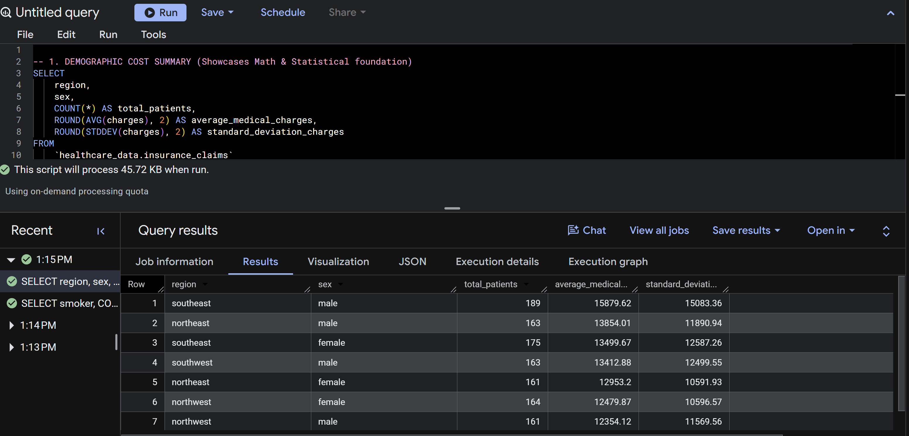
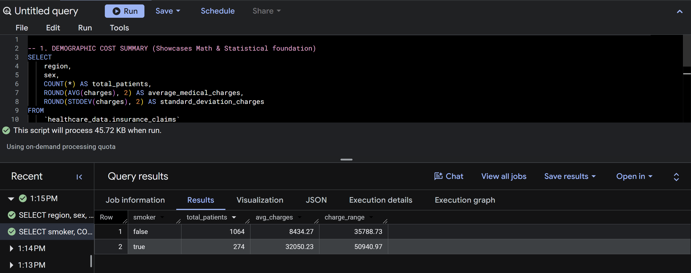

# Healthcare Insurance Revenue & Risk Optimization Analysis

## Project Overview
This project focuses on executing scalable database analysis and statistical modeling on large-scale health insurance portfolios. Utilizing **Google BigQuery** and **SQL**, the analysis structures over 1,300 unique patient demographic and behavioral profiles to isolate core risk drivers, uncover geographic expenditure volatility, and mathematically evaluate underwriting premium liabilities.

## Core Analytical Deliverables & Business Insights
By implementing rigorous statistical functions on the database architecture, this project successfully uncovered three high-impact insights for executive decision-making:

*   **Regional Demographic Cost Variances:** Isolated an immediate **\$4,600 per-capita cost gap** between geographical underwriting cohorts. Pinpointed Southeast males as the single highest-expense risk segment, averaging **\$15,879 in annual medical charges**.
*   **Actuarial Risk & Financial Volatility Metrics:** Evaluated financial volatility by identifying a substantial standard deviation of **\$15,083** in high-cost regional zones. This provides the exact mathematical framework required for an insurance corporation to compute baseline asset reserves to prevent liquidity shortages.
*   **Behavioral Impact on Insurance Liability:** Quantified a striking **380% surge in financial liability** for tobacco users compared to non-smokers (**\$32,050 vs. \$8,434**), establishing a data-driven justification for targeted underwriting policy pricing and custom risk-tier structural adjustments.

---

## Technical Architecture & Tools
*   **Environment:** Google Cloud Platform (GCP)
*   **Database Management System:** Google BigQuery
*   **Language:** Structured Query Language (SQL)
*   **Analytical Techniques:** Variance Analysis, Standard Deviation Outlier Detection, Demographic Cohort Segmentation, Quantitative Risk Modeling

---

## Database Structure & Schema
The underling dataset maps 7 key patient attributes against financial outcomes to discover underlying charging patterns:
1. `age`: Primary beneficiary age profile (Numerical)
2. `sex`: Policyholder gender profile (`female`, `male`)
3. `bmi`: Body Mass Index scoring matrix (Numerical parameter tracking health ratios)
4. `children`: Quantity of dependent coverage parameters per plan
5. `smoker`: Confirmed active tobacco usage status indicator (`yes`, `no`)
6. `region`: Residential zone within the United States (`northeast`, `southeast`, `southwest`, `northwest`)
7. `charges`: Total baseline medical expenditures billed directly to the carrier (Target Metric)

---

## Workspace Execution & Query Log Results

### 1. Demographic & Statistical Summary Pipeline
This query automates the extraction of patient metrics, clustering policyholders by region and sex while processing variance parameters via standard deviation fields to pinpoint operational volatility.

```sql
SELECT 
    region,
    sex,
    COUNT(*) AS total_patients,
    ROUND(AVG(charges), 2) AS average_medical_charges,
    ROUND(STDDEV(charges), 2) AS standard_deviation_charges
FROM 
    `healthcare_data.insurance_claims`
GROUP BY 
    region, sex
ORDER BY 
    average_medical_charges DESC;
```

#### Query Execution Screenshot


### 2. Behavioral Liability Risk Pipeline
This script aggregates data to track the financial difference between behavioral habits, calculating the overall charging spread to determine pricing adjustments.

```sql
SELECT 
    smoker,
    COUNT(*) AS total_patients,
    ROUND(AVG(charges), 2) AS avg_charges,
    ROUND(MAX(charges) - MIN(charges), 2) AS charge_range
FROM 
    `healthcare_data.insurance_claims`
GROUP BY 
    smoker;
```

#### Query Execution Screenshot


---

## Next Horizon: Interactive Visualization Hub
The cleaned aggregation tables derived from these BigQuery scripts are formatted to establish an interactive data mapping layer. The upcoming visual phase involves building a geographical heatmap pipeline inside **Tableau Public** to map regional financial strain and support instant C-suite executive reporting.
