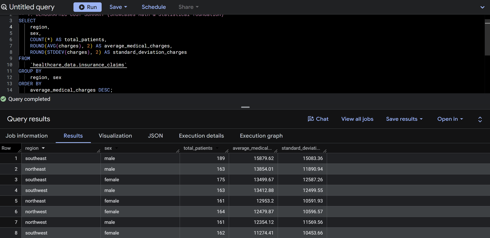
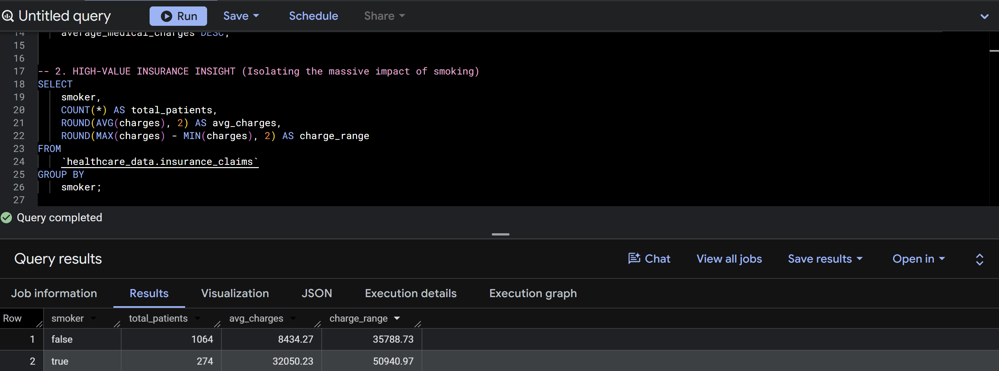

# Healthcare Insurance Cost & Risk Analysis

SQL analysis of 1,338 patient records in Google BigQuery, examining how region, sex, and smoking status relate to annual medical charges.

## Project Overview

Health insurers need to understand which groups cost the most and how widely costs vary. This project uses SQL in Google BigQuery to segment a health insurance dataset by region, sex, and smoking status, then measures average cost, spread, and the gaps between groups.

**Tools:** Google BigQuery, SQL (Google Cloud Platform)
**Techniques:** Aggregation, grouping, standard deviation, cohort comparison

## Dataset

- **Source:** [US Health Insurance Dataset](https://www.kaggle.com/datasets/teertha/ushealthinsurancedataset/data) on Kaggle
- **Size:** 1,338 rows, 7 columns
- **Table:** `healthcare_data.insurance_claims` (note: each row is one person's annual charges, not an individual claim)

| Column | Description |
|---|---|
| `age` | Age of the primary beneficiary |
| `sex` | `female` or `male` |
| `bmi` | Body mass index |
| `children` | Number of dependents covered |
| `smoker` | `yes` or `no` |
| `region` | `northeast`, `southeast`, `southwest`, or `northwest` |
| `charges` | Annual medical charges billed to the insurer (target metric) |

## Key Findings

1. **Regional cost gap:** Southeast males were the highest-cost group, averaging **$15,879** in annual charges, about **$4,600** more than Southwest females, the lowest-cost group.
2. **Cost variability:** Charges for Southeast males, the highest-cost group, had a standard deviation of **$15,083**, roughly equal to their $15,879 average. A spread this large relative to the average means costs are hard to predict for an individual, which matters for reserve planning.
3. **Smoking:** Smokers averaged **$32,050** in annual charges versus **$8,434** for non-smokers, about **3.8x higher** (a 280% increase).

## Queries

### 1. Cost and variability by region and sex

Groups policyholders by region and sex and reports patient count, average charges, and standard deviation.

```sql
SELECT 
    region,
    sex,
    COUNT(*) AS total_patients,
    ROUND(AVG(charges), 2) AS average_medical_charges,
    ROUND(STDDEV(charges), 2) AS standard_deviation_charges
FROM 
    `healthcare_data.insurance_claims`
GROUP BY 
    region, sex
ORDER BY 
    average_medical_charges DESC;
```



### 2. Smoker vs. non-smoker charges

Compares patient count, average charges, and the min-to-max range of charges by smoking status.

```sql
SELECT 
    smoker,
    COUNT(*) AS total_patients,
    ROUND(AVG(charges), 2) AS avg_charges,
    ROUND(MAX(charges) - MIN(charges), 2) AS charge_range
FROM 
    `healthcare_data.insurance_claims`
GROUP BY 
    smoker;
```



<!--
OPTIONAL: Uncomment this section only after you have run the query and saved a screenshot.

### 3. Outlier detection

Flags records with charges more than 3 standard deviations above the mean.

SELECT *
FROM (
    SELECT *,
        AVG(charges) OVER () AS mean_charges,
        STDDEV(charges) OVER () AS sd_charges
    FROM `healthcare_data.insurance_claims`
)
WHERE charges > mean_charges + 3 * sd_charges
ORDER BY charges DESC;
-->

## Limitations

- **Correlation, not causation.** The comparisons are simple group averages. Age, BMI, and other factors were not held constant, so the gaps (especially smoker vs. non-smoker) may partly reflect differences in those variables.
- **Small, static dataset.** 1,338 records is enough to show patterns but not to generalize to a full insurance portfolio.
- **Region is coarse.** Four regions hide variation within each one.
- **Standard deviation is descriptive.** It shows how widely charges vary but is not, on its own, a reserving model.

## Next Steps

- Build a Tableau Public dashboard with a regional cost map and smoker/non-smoker comparison (link to be added)
- Add a query that controls for age and BMI before comparing groups
- Add outlier detection on charges

## Author

Raevin Rodriguez
